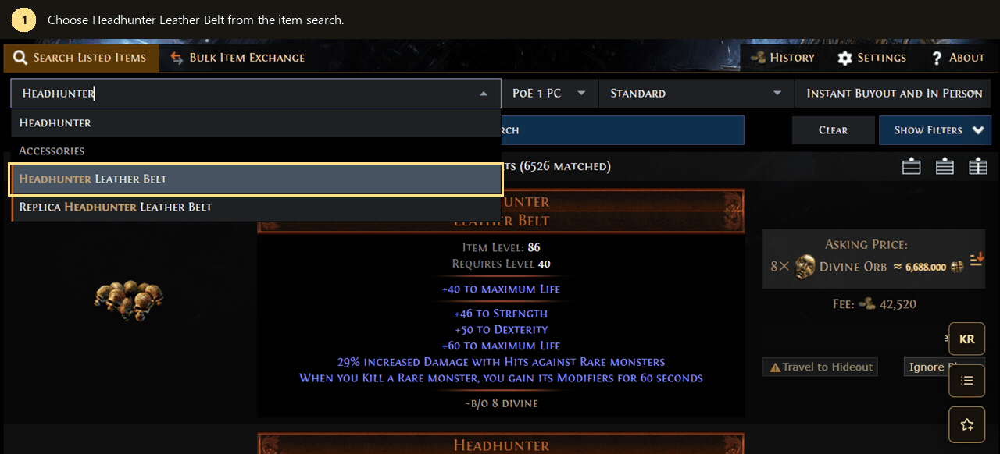
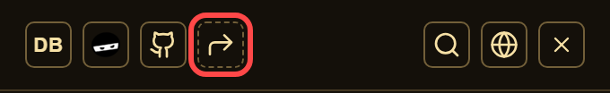

# PoE TradeMark

English · [한국어](#한국어)

PoE TradeMark is a Chrome extension for saving Path of Exile and Path of Exile 2 trade searches. Reopen a search from your bookmarks, share a collection with another player, or open trade links with your preferred league and trade mode. Each game has its own bookmark list.

## Install in Chrome

1. Clone or download this repository. If you downloaded a ZIP, extract it.
2. Open `chrome://extensions` and enable **Developer mode**.
3. Click **Load unpacked**, select the repository’s `extension` folder, and refresh your trade tab.

## Save your first search

1. On the English PoE1 trade site, type **Headhunter** in the item search. Choose **Headhunter Leather Belt** under **Accessories**, then click **Search**.
2. With the results on screen, click the **star** at the bottom right. A green check confirms that the search was saved to your selected collection.
3. Click the **list** button just above the star. You’ll see **Headhunter Leather Belt** in the sidebar. Use **»** to reopen the search later or the pencil to rename it. You can also open your bookmarks from the extension icon in Chrome.

## Organize and share bookmarks

A **collection** is a list you can switch or share, such as the gear searches for one build. A **group** keeps related bookmarks together inside that list.

- **Collections.** Each game starts with a **My bookmarks** collection. Use the selector above your bookmarks to switch collections and **+** to create one. Use **⋯** to rename or delete the selected collection. Deleting it also removes its bookmarks and groups. After deleting the last collection, click **+** to create one or import a collection to start saving searches again.
- **Share a collection.** Choose **⋯ → Export collection** to download its bookmarks, groups and order as JSON. On the same game's trade site, choose **⋯ → Import collection** to load the file. You can merge it into the current collection, replace the current collection after confirmation, or create a new collection.

### Group related searches

For example, keep two belt searches together in a **Belts** group inside your build collection.

1. Drag one search onto the **center** of the other ungrouped search. When the row highlights, release to group them. To start with a single search, right-click it and choose **Group**. Right-click the group heading and choose **Rename** to name it **Belts**.
2. To add another search, drop it on the group heading or right-click it and choose **Move to group → Belts**. The most recently used group also has a shortcut in this menu. Click the group name to collapse or expand it.
3. Drop an entry on the **line between rows** to change its position. To take one search out, drag it to a line outside the group or right-click it and choose **Remove from group**.
4. To dissolve the group, right-click its heading and choose **Ungroup**. Its searches stay in the collection. To move the group and its searches together, choose **Move to collection**.

## Open searches with your trade preferences

Open the bookmark sidebar and click the **arrow immediately to the right of GitHub**, outlined in red below. The arrow opens **Preferences**. Once you choose a trade site, its country code appears in the same spot.

You can also open the extension popup to find the same settings.

| What you want to do | How |
| --- | --- |
| Open incoming links with your usual settings | Choose a trade site, league or trade mode and turn on **Auto-redirect**. Leave any field at **—** to keep the value from the link. League and trade mode are saved per game. |
| Use the settings from a search you already have open | Run the search, then click **Current page snapshot** to save its site, league and trade mode as your preferences. |
| Follow the regular challenge league each season | Choose **Current challenge league (softcore)**. The list comes from the official trade site. Click the refresh arrow beside **League** to fetch it again. |
| Switch sites for just one visit | Use the country-code button on the trade page to apply your preferences manually. To open a bookmark on a specific country’s site for one visit, use the dropdown beside its double arrow. |

The extension supports the Korean, global and international-language trade sites. Taiwan bookmarks open on the Taiwan trade site. If a search cannot be converted, you can open the original link.

## Compare prices

In the sidebar, choose a base currency to see listing prices converted with poe.ninja rates. For example, select **Divine Orb** to compare prices listed in different currencies. Open the rate table and use its edit button to save currency pairs you check often.

## Credits and privacy

PoE TradeMark is an unofficial fan project. Path of Exile and the bundled currency icons belong to Grinding Gear Games. Bookmarks and preferences are stored locally in Chrome. [Privacy policy](PRIVACY.md)

Item-name translations use community game data and the Korean trade catalog. [PoE1 translations](https://github.com/gw1108/PathOfExile_Translated) · [PoE2 translations](https://github.com/Kvan7/Exiled-Exchange-2) · [Korean game data](https://github.com/west-duo/poe-game-data)

---

## 한국어

[English](#poe-trademark) · 한국어

PoE TradeMark는 **패스 오브 엑자일 1과 2의 거래소 검색 조건을 즐겨찾기로 저장하는 크롬 확장 프로그램**입니다. 저장한 검색을 다시 열거나, 빌드 하나에 필요한 검색을 컬렉션으로 묶어 다른 사람과 공유할 수 있습니다. 거래소 링크를 열 때 원하는 국가, 리그, 거래 방식도 적용할 수 있습니다. 현재 거래소 주소에 맞춰 각 게임의 컬렉션을 보여줍니다.

### 크롬에 설치하기

1. 저장소를 복제하거나 ZIP으로 내려받아 압축을 풉니다.
2. 크롬에서 `chrome://extensions`를 열고 **개발자 모드**를 켭니다.
3. **압축해제된 확장 프로그램을 로드합니다**를 눌러 저장소의 `extension` 폴더를 선택한 다음, 거래소 탭을 새로고침합니다.

### 첫 검색 저장하기

아래 예시는 영문 POE1 거래소에서 헤드헌터 허리띠 검색을 저장하는 과정입니다.

1. 거래소 검색창에 **Headhunter**를 입력하고 **Accessories** 아래의 **Headhunter Leather Belt**를 선택한 다음 **Search**를 누릅니다.
2. 검색 결과가 뜨면 오른쪽 아래의 **별 버튼**을 누릅니다. 초록색 체크가 나타나면 현재 컬렉션에 저장된 것입니다.
3. 별 바로 위의 **목록 버튼**을 누르면 사이드바에 저장한 검색이 보입니다. **»**를 누르면 같은 조건으로 거래소를 다시 열고, 연필 버튼을 누르면 즐겨찾기 이름을 수정합니다. 크롬의 확장 프로그램 아이콘에서도 목록을 열 수 있습니다.

### 컬렉션 정리와 공유

**컬렉션**은 빌드별로 전환하거나 다른 사람과 공유할 수 있는 즐겨찾기 목록입니다. **그룹**은 그 컬렉션 안에서 관련 검색을 묶는 단위입니다.

- **만들기와 전환** — 처음에는 게임마다 **내 즐겨찾기** 컬렉션이 하나씩 있습니다. 목록 위의 **+**로 컬렉션을 만들고, 옆의 선택 상자에서 컬렉션을 바꿉니다.
- **이름 수정과 삭제** — **⋯**에서 선택한 컬렉션의 이름을 바꾸거나 삭제할 수 있습니다. 삭제하면 그 안의 즐겨찾기와 그룹도 함께 삭제됩니다. 마지막 컬렉션까지 삭제한 경우 **+**로 새 컬렉션을 만들거나 컬렉션을 가져오면 다시 즐겨찾기를 저장할 수 있습니다.
- **공유** — **⋯ → 컬렉션 내보내기**를 누르면 즐겨찾기, 그룹, 표시 순서가 JSON 파일에 담깁니다. 받는 사람은 같은 게임의 거래소에서 **컬렉션 가져오기**를 눌러 파일을 선택합니다. 현재 컬렉션에 합치거나, 확인 후 내용을 교체하거나, 새 컬렉션으로 추가할 수 있습니다.

#### 관련 검색을 그룹으로 묶기

예를 들어 빌드 컬렉션 안에서 허리띠 검색 두 개를 **허리띠** 그룹으로 묶을 수 있습니다.

1. 즐겨찾기 하나를 그룹 밖에 있는 다른 즐겨찾기의 **가운데로 드래그합니다**. 항목 전체가 강조될 때 놓으면 두 즐겨찾기가 한 그룹이 됩니다. 하나만 먼저 묶으려면 해당 항목을 우클릭해 **그룹화**를 선택합니다. 그룹 이름을 우클릭해 **이름 수정**을 선택하고 그 자리에서 **허리띠**라고 입력합니다.
2. 그룹에 즐겨찾기를 추가하려면 그룹 이름 위로 드래그하거나, 항목을 우클릭해 **그룹으로 이동 → 허리띠**를 선택합니다. 최근에 사용한 그룹은 우클릭 메뉴에서 바로 선택할 수 있습니다. 그룹 이름을 클릭하면 접거나 펼칩니다.
3. 순서를 바꾸려면 항목을 드래그해 **항목 사이에 나타나는 선**에 놓습니다. 한 항목만 그룹에서 빼려면 그룹 밖의 선으로 드래그하거나, 항목을 우클릭해 **그룹에서 빼기**를 선택합니다.
4. 그룹 이름을 우클릭해 **그룹 해제**를 선택하면 안에 있던 즐겨찾기가 컬렉션 목록으로 돌아옵니다. 그룹 전체를 다른 컬렉션으로 옮길 때는 **컬렉션으로 이동**을 선택합니다.

### 선호하는 거래소 설정으로 열기

거래소에서 즐겨찾기 사이드바를 열고 **GitHub 아이콘 바로 오른쪽의 화살표 버튼**을 누르면 **선호 설정**이 열립니다. 아래 빨간 테두리가 해당 버튼입니다. 거래소를 선택하면 같은 자리에 화살표 대신 `KR`, `EN` 같은 국가 코드가 표시됩니다.

크롬의 확장 프로그램 팝업에서도 같은 설정을 볼 수 있습니다.

| 하고 싶은 일 | 방법 |
| --- | --- |
| 받은 링크를 평소 쓰는 조건으로 열기 | 거래소, 리그, 거래 방식을 선택하고 **자동 이동**을 켭니다. **—**로 둔 항목은 링크의 값을 따릅니다. 리그와 거래 방식은 게임별로 저장됩니다. |
| 지금 보고 있는 거래소 설정 가져오기 | 원하는 조건으로 검색을 실행한 뒤 **현재 페이지 스냅샷**을 누릅니다. 해당 페이지의 거래소, 리그, 거래 방식이 선호 설정에 들어갑니다. |
| 시즌마다 최신 일반 리그 사용하기 | 리그에서 **최신 일반 시즌**을 선택합니다. 공식 거래소에서 리그 목록을 받아오며, 리그 옆 새로고침 버튼을 눌러 목록을 갱신할 수 있습니다. |
| 이번 검색만 다른 거래소에서 열기 | 거래소 페이지의 국가 코드 버튼을 누르면 현재 검색에 선호 설정을 적용합니다. 저장한 검색을 특정 국가의 거래소에서 한 번 열려면 즐겨찾기의 **»** 옆 드롭다운에서 국가를 고릅니다. |

한국, 글로벌 및 여러 언어의 거래소를 지원합니다. 대만 거래소에서 저장한 즐겨찾기는 대만 거래소에서 열립니다. 검색 조건을 변환할 수 없는 경우 원본 링크를 열 수 있습니다.

### 가격 비교

사이드바에서 기준 화폐를 고르면 poe.ninja 시세로 환산한 가격을 볼 수 있습니다. 예를 들어 **신성한 오브**를 선택하면 서로 다른 화폐로 올라온 매물을 같은 단위로 비교할 수 있습니다. 환율표의 편집 버튼으로 자주 확인하는 화폐 쌍을 저장할 수 있습니다.

### 출처와 개인정보

PoE TradeMark는 비공식 팬 프로젝트입니다. 패스 오브 엑자일과 확장 프로그램에 포함된 화폐 아이콘의 권리는 Grinding Gear Games에 있습니다. 즐겨찾기와 선호 설정은 크롬의 로컬 저장소에 보관합니다. [개인정보 처리방침](PRIVACY.md)

아이템 이름 변환에는 커뮤니티 게임 데이터와 한국 거래소의 아이템 목록을 사용합니다. [POE1 번역 데이터](https://github.com/gw1108/PathOfExile_Translated) · [POE2 번역 데이터](https://github.com/Kvan7/Exiled-Exchange-2) · [한국어 게임 데이터](https://github.com/west-duo/poe-game-data)
