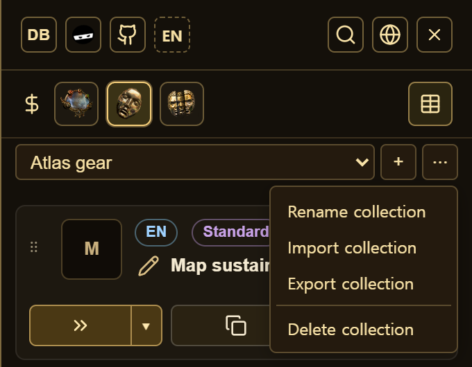
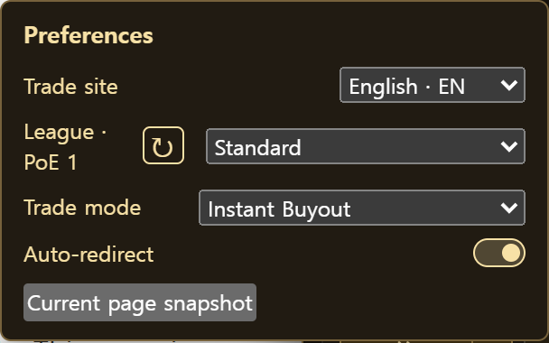

# PoE TradeMark

PoE TradeMark is a Chrome extension for saving Path of Exile and Path of Exile 2 trade searches. Reopen a search from your bookmarks, share a collection with another player, or open trade links with your preferred league and trade mode. Each game has its own bookmark list.

## Install in Chrome

1. Clone or download this repository. If you downloaded a ZIP, extract it.
2. Open `chrome://extensions` and enable **Developer mode**.
3. Click **Load unpacked**, select the repository’s `extension` folder, and refresh your trade tab.

## Save your first search

1. On the English PoE1 trade site, type **Headhunter** in the item search. Choose **Headhunter Leather Belt** under **Accessories**, then click **Search**.
2. With the results on screen, click the **star** at the bottom right. A green check confirms that the search was saved to your selected collection.
3. Click the **list** button just above the star. You’ll see **Headhunter Leather Belt** in the sidebar. Use **»** to reopen the search later or the pencil to rename it. You can also open your bookmarks from the extension icon in Chrome.

## Organize and share bookmarks

A **collection** is a list you can switch or share, such as the gear searches for one build. A **group** keeps related bookmarks together inside that list.

- **Collections.** Use the selector above your bookmarks to switch lists and **+** to create one. The **⋯** menu lets you rename or delete the selected collection, including the starting **My bookmarks** collection. Deleting a collection also deletes its bookmarks and groups. If you delete your last collection, you get an empty list for your next search.
- **Groups.** Drag a bookmark onto another to group them, or drop it on the line between entries to reorder it. Click a group name to expand or collapse it. Right-click a bookmark for **Move to group**, or right-click a bookmark or group for **Move to collection**.
- **Share a collection.** Choose **⋯ → Export collection** to download its bookmarks, groups and order as JSON. On the same game's trade site, choose **⋯ → Import collection** to load the file. You can merge it into the current collection, replace the current collection after confirmation, or create a new collection.

## Open searches with your trade preferences

Open **Preferences** in the popup or click the redirect arrow beside GitHub in the sidebar. When you choose a trade site, its country code appears on the button.

| What you want to do | How |
| --- | --- |
| Open incoming links with your usual settings | Choose a trade site, league or trade mode and turn on **Auto-redirect**. Leave any field at **—** to keep the value from the link. League and trade mode are saved per game. |
| Use the settings from a search you already have open | Run the search, then click **Current page snapshot** to save its site, league and trade mode as your preferences. |
| Follow the regular challenge league each season | Choose **Current challenge league (softcore)**. The list comes from the official trade site. Click the refresh arrow beside **League** to fetch it again. |
| Switch sites for just one visit | Use the country-code button on the trade page to apply your preferences manually. To open a bookmark on a specific country’s site for one visit, use the dropdown beside its double arrow. |

The extension supports the Korean, global and international-language trade sites. Taiwan bookmarks open on the Taiwan trade site. If a search cannot be converted, you can open the original link.

## Compare prices

In the sidebar, choose a base currency to see listing prices converted with poe.ninja rates. For example, select **Divine Orb** to compare prices listed in different currencies. Open the rate table and use its edit button to save currency pairs you check often.

## Credits and privacy

PoE TradeMark is an unofficial fan project. Path of Exile and the bundled currency icons belong to Grinding Gear Games. Bookmarks and preferences are stored locally in Chrome. [Privacy policy](PRIVACY.md)

Item-name translations use community game data and the Korean trade catalog. [PoE1 translations](https://github.com/gw1108/PathOfExile_Translated) · [PoE2 translations](https://github.com/Kvan7/Exiled-Exchange-2) · [Korean game data](https://github.com/west-duo/poe-game-data)
